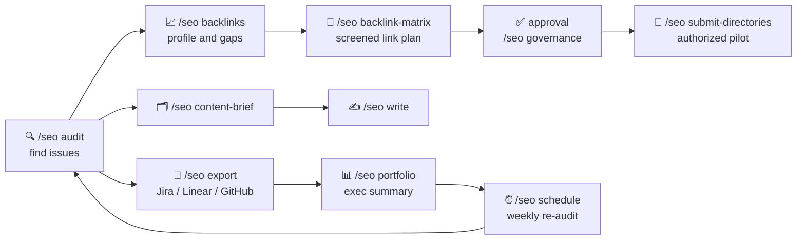

<p align="center">
  
</p>

<p align="center">
  <a href="https://github.com/DataSpoof/Web-SEO/actions/workflows/ci.yml"></a>
  
  
  
  
  <a href="licenses/"></a>
</p>

<p align="center">
  <b>The complete SEO toolkit for Claude Code.</b><br>
  Run a full-site audit, turn competitor gaps into a backlink plan, write platform-native articles,<br>
  and manage it all across clients with approvals, budgets and an audit trail.
</p>

<p align="center">
  <a href="#-quick-start">Quick start</a> &nbsp;•&nbsp;
  <a href="#-whats-inside">What's inside</a> &nbsp;•&nbsp;
  <a href="#-commands">Commands</a> &nbsp;•&nbsp;
  <a href="#-how-it-fits-together">Workflow</a> &nbsp;•&nbsp;
  <a href="#-built-for-teams">For teams</a> &nbsp;•&nbsp;
  <a href="#-safety-first">Safety</a>
</p>

---

## ✨ Why Web-SEO

Most SEO tooling stops at the report. Web-SEO keeps going: it finds what is wrong,
plans the links, writes the content, and turns findings into tickets your team can
track, without ever submitting, emailing or publishing anything you did not approve.

It brings together two proven open-source projects and adds an enterprise layer:

| | Source | What it brings |
|---|---|---|
| 🔍 | **[claude-seo](https://github.com/AgriciDaniel/claude-seo)** by AgriciDaniel | Audits, technical SEO, E-E-A-T, schema, Core Web Vitals, local and maps, AI search (GEO), agent readiness, backlink analysis, clustering, drift monitoring, Google APIs |
| 🔗 | **[backlink_skills](https://github.com/flaqai/backlink_skills)** by Flaq AI | Backlink prospecting matrix, product-directory submission, SEO / LinkedIn / Medium / WeChat writers, multi-platform blog campaigns, 743 link leads |
| 🏢 | **Enterprise layer** (new here) | Client workspaces, approval ledger, budget caps, audit log, Jira / Linear / GitHub / Slack exports, portfolio reports, scheduled monitoring |

**46 sub-skills and 19 sub-agents**, all reachable from a single `/seo` command.

## 🚀 Quick start

**1. Add the marketplace and install** (inside Claude Code):

```
/plugin marketplace add DataSpoof/Web-SEO
/plugin install web-seo@web-seo-local
```

**2. Set up the runtime once** (an isolated Python environment plus headless Chromium):

```
/seo setup
```

**3. Run your first audit:**

```
/seo audit https://your-site.com
```

That's it. `/seo doctor` checks readiness at any time.

<details>
<summary><b>Requirements and install notes</b></summary>

- Claude Code 1.0.33 or newer, and Python 3.11 to 3.14.
- Node.js 18+ for the writer audit scripts and the optional Cloudflare R2 image upload.
- The blog campaign release builder needs `markdown-it-py==3.0.0`
  (`skills/blog-human-handoff/scripts/requirements.txt`).
- On Windows, set `PYTHONUTF8=1` before using the blog campaign tools; their files
  are UTF-8 Chinese text.
- Installing from a local clone works too: `/plugin marketplace add ./Web-SEO`.
- Already have the original `claude-seo` plugin? Disable it in `/plugin` so the
  shared skills are not loaded twice.
- Do not use the bundled `install.sh` / `install.ps1`: those upstream manual
  installers download claude-seo only, without the link-building and enterprise skills.

</details>

## 🧰 What's inside

<table>
<tr>
<td width="33%" valign="top">

### 🔍 Analyze
- Full-site audit, 0-100 health score
- Technical SEO in 9 categories
- E-E-A-T and content quality
- Schema.org detect / validate / generate
- Core Web Vitals (INP) and PageSpeed
- Local SEO, GBP, geo-grid maps
- AI Overviews, ChatGPT, Perplexity (GEO)
- Agent readiness, llms.txt, WebMCP
- Backlink profile and toxic links
- Drift monitoring after deploys
- E-commerce, hreflang, SXO

</td>
<td width="33%" valign="top">

### 🔗 Build and write
- Dual-track backlink prospecting
- Semrush and competitor-gap sources
- Free / Paid execution workbooks
- Directory submission: batch, quality, merged
- 743-entry backlink candidate list
- SEO articles with fact-check and audit
- LinkedIn, Medium, WeChat writers
- Multi-platform blog campaigns with
  independent review
- Content briefs and topic clusters

</td>
<td width="33%" valign="top">

### 🏢 Operate
- One workspace per client
- Org policy: allow, approve or deny
- Approval ledger with expiry and counts
- Monthly and per-run budget caps
- Tamper-evident audit log
- Jira, Linear, GitHub Issues exports
- Slack and Teams summaries
- Run-to-run regression diffs
- White-label portfolio reports
- Scheduled audits in CI or cron

</td>
</tr>
</table>

## 📋 Commands

<details open>
<summary><b>🔍 SEO analysis</b></summary>

| Command | What it does |
|---|---|
| `/seo audit <url>` | Full website audit with parallel agents and an SEO Health Score |
| `/seo page <url>` | Deep single-page analysis |
| `/seo technical <url>` | Crawlability, indexability, security, rendering, Core Web Vitals |
| `/seo content <url>` | E-E-A-T, readability, thin content, AI citation readiness |
| `/seo content-brief <topic>` | Competitive brief: keywords, outline, word counts, internal links |
| `/seo schema <url>` | Structured data detection, validation and generation |
| `/seo sitemap <url or generate>` | Validate or generate XML sitemaps |
| `/seo images <url>` | Alt text, formats, sizes, lazy loading, image SERP |
| `/seo geo <url>` | Optimize for AI Overviews and answer engines |
| `/seo agentic <url>` | Lighthouse Agentic Browsing, AI agent access, WebMCP |
| `/seo local <url>` · `/seo maps` | GBP, NAP, citations, reviews, geo-grid rank tracking |
| `/seo backlinks <url>` | Profile from Moz, Bing, Common Crawl and DataForSEO |
| `/seo cluster <seed>` | SERP-overlap clustering and hub-and-spoke architecture |
| `/seo sxo <url>` | Page-type mismatch, user stories, persona scoring |
| `/seo drift baseline\|compare\|history <url>` | Catch SEO regressions after changes |
| `/seo ecommerce <url>` | Product schema, Shopping and marketplace intelligence |
| `/seo hreflang [url]` | International SEO and cultural adaptation |
| `/seo plan <type>` | Strategy by industry: SaaS, local, e-commerce, publisher, agency |
| `/seo programmatic` · `/seo competitor-pages` | Pages at scale and "X vs Y" comparisons |
| `/seo flow [stage]` | FLOW framework prompts: Find, Leverage, Optimize, Win |
| `/seo google [command]` | Search Console, PageSpeed, CrUX, GA4, Indexing API, PDF reports |

Optional MCP extensions: `/seo dataforseo`, `/seo image-gen`, `/seo firecrawl`,
`/seo ahrefs`, `/seo bing`, `/seo matomo`, `/seo profound`, `/seo seranking`,
`/seo unlighthouse` (see [`extensions/`](extensions/)).

</details>

<details open>
<summary><b>🔗 Link building and writing</b></summary>

| Command | What it does |
|---|---|
| `/seo backlink-matrix` | Source prep, batch and editorial tracks, dedup, frozen batches, Free/Paid workbooks |
| `/seo submit-directories quality` | Quality-first pilot of up to 10 relevant directories |
| `/seo submit-directories batch` | High-throughput queue for large prequalified lists |
| `/seo submit-directories merged` | Directory forms plus one-to-one official contact requests |
| `/seo backlink-list` | Browse the 743-entry candidate list (recheck before use) |
| `/seo write general\|linkedin\|medium\|wechat` | Fact-checked, audited, humanized articles and publishing packs |
| `/seo blog-campaign` | Multi-article campaign: gatekeeper, writer, independent reviewer |

</details>

<details open>
<summary><b>🏢 Enterprise operations</b></summary>

| Command | What it does |
|---|---|
| `/seo workspace` | Client profiles and isolated folders for audits, reports, links and content |
| `/seo governance` | Policy checks, approvals, spend tracking, audit log, retention |
| `/seo export` | Findings to Jira, Linear, GitHub Issues, CSV, Markdown, Slack, Teams; diffs |
| `/seo portfolio` | Multi-site roll-up, risk ranking, white-label HTML executive summary |
| `/seo schedule` | Recurring audits and drift checks for GitHub Actions, cron, Task Scheduler |

</details>

> 💡 **No need to memorize commands.** Every skill also triggers from plain language:
> *"find guest-post opportunities for my SaaS"* or *"write a Medium story about our launch"*
> works without the `/seo` prefix. Full reference: [docs/COMMANDS.md](docs/COMMANDS.md).

## 🔄 How it fits together



## 🏢 Built for teams

Agencies and in-house teams get the controls they need to run SEO at scale:

- **🗂️ Client isolation.** Every client gets its own profile and folders; work never
  mixes across accounts.
- **✅ Approvals that leave a trail.** Risky actions (directory submissions, outreach,
  Indexing API) need a recorded approval with a named approver, scope, use count and
  expiry. Publishing, payments and CAPTCHA bypass are never delegated.
- **💰 Spend control.** Per-run and monthly budget caps for paid data APIs.
- **🧾 Audit log.** Hash-chained, so any edited or deleted entry is detected.
- **🔐 Secret guard.** A hook blocks API keys from being written into project files.
- **🚢 Org-wide rollout.** A managed-settings template, CI quality gates, pre-commit
  hooks and incident runbooks.

Read the full [Enterprise Guide](docs/ENTERPRISE.md).

## 🛡️ Safety first

Web-SEO is built to do link building the right way, not to spam:

| Never without your approval | Never, period |
|---|---|
| Registering or logging in | Bypassing CAPTCHA, 2FA or email verification |
| Submitting a form | Paying for links or forced reciprocal links |
| Sending an email | Inventing profiles, reviews or facts |
| Calling the Indexing API or IndexNow | Reporting a link as live without evidence |

Fetched pages are always treated as untrusted data, never as instructions.

## 🌐 Language note

Some instruction files inherited from backlink_skills (the backlink matrix, the
merged directory skill, the blog campaign and the WeChat writer) are written in
Chinese, as upstream. Claude follows them as written and replies in your language;
their trigger descriptions are in English.

## 📁 Project layout

```
.claude-plugin/   plugin manifest and marketplace (web-seo@web-seo-local)
skills/           46 sub-skills (+4 internal blog-campaign tool folders)
agents/           19 sub-agents
scripts/          Python tools and the claude-seo launcher
hooks/            schema validation, secret guard, audit log hooks
extensions/       optional MCP extensions (DataForSEO, Firecrawl, Ahrefs, ...)
enterprise/       JSON schemas, example policy and profiles, managed settings
data/             Google updates ledger, backlink candidate list
templates/        blog campaign templates
docs/             commands, enterprise guide, merge map, upstream READMEs
tests/            test suites (claude-seo, blog workflow, enterprise layer)
```

How every upstream file was mapped: [docs/MERGED-FEATURES.md](docs/MERGED-FEATURES.md).

## 🧪 Development

```bash
pip install -r requirements.txt pytest
python -m pytest tests skills
```

CI runs lint, the full suite on Python 3.11, 3.12 and 3.14, Windows and macOS
portability, a credential scan, dependency audits and the enterprise checks.

## 🙏 Credits and license

Web-SEO stands on the work of two MIT-licensed projects:

- **[claude-seo](https://github.com/AgriciDaniel/claude-seo)**, Copyright (c) 2026 agricidaniel ([license](licenses/claude-seo-LICENSE))
- **[backlink_skills](https://github.com/flaqai/backlink_skills)**, Copyright (c) 2026 Flaq AI ([license](licenses/backlink_skills-LICENSE))

The FLOW prompt library in `skills/seo-flow` is CC BY 4.0. Original READMEs are kept in
[docs/upstream/](docs/upstream/).

<p align="center"><sub>If Web-SEO helps you, a ⭐ on the repo helps others find it.</sub></p>
